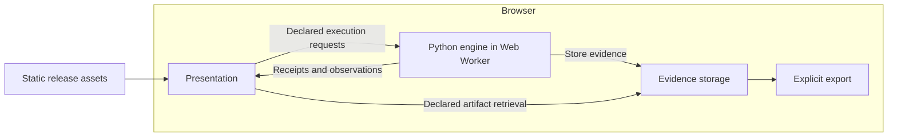

# Website architecture and execution parity

This document owns website delivery, runtime placement and pre-deployment confidence.
[Execution delivery](delivery.md) owns evidence representation and retrieval;
[inspection](inspection.md) owns the connected views. Interface shapes remain owned
by the [data model](../../data-model/README.md).

## Primary hypothesis: execute in the browser

The public site should serve static assets and run the shared Python engine in the
visitor's browser. Pyodide in a Web Worker is the primary implementation direction. The
[feasibility spike](../research/browser-execution-spike.md) passed for the reference
model and existing KV simulation on desktop Chromium. Production UI integration,
broader browser/device qualification and larger simulations remain unproven.
Remote compute is an alternative only if measured limitations or a specific lab
justify it. Lambda is no longer the planned deployment target.

For the current tiny model and hypothetical resource simulations, Lambda would
move CPU computation elsewhere without making the abstraction more representative.
Browser execution avoids mandatory prompt uploads, remote evidence storage and
compute-service operations. It still has asset-delivery costs, runtime startup
costs and device-dependent limits; those must be measured.

## Preserve interfaces independently of placement

| Boundary | Owns | Does not own |
| --- | --- | --- |
| Presentation | Editing, submission, selection, rendering and inspection | Numerical equations, resource scheduling or alternate settings |
| Execution | Validation, numerical work, resource simulation and observations | DOM updates or website assembly |
| Evidence storage | Identified immutable records, artifact retrieval and export | Model policy or the simulated memory hierarchy |
| Transport/runtime | Carry declared requests and results; supply execution capabilities | Change operation meaning according to deployment location |

These interfaces remain essential when components share a browser. Presentation
must not reach into Python globals or storage internals, mutate accepted evidence,
or reimplement model algorithms. Worker messaging must consume the same generated
request/result declarations and enforce validation at the boundary. Runtime-specific
message envelopes must be declared and governed before implementation, not invented
inside UI code. Request correlation, failures and lifecycle behavior need explicit
semantics; placing code in a worker does not establish them automatically.

HTTP is one transport binding, not a requirement for executing an experiment. The
browser need not simulate a web server to preserve the interface. Native CLI and
HTTP consumers retain the same domain contracts. Existing receipt and artifact
interfaces remain useful for separating compute from inspection and storage;
co-location is not permission to collapse them into shared mutable objects.

Browser evidence may initially live in memory with explicit export. Persistence
across reloads, storage quotas and eviction require declared behavior before a
persistent browser store is offered. No receipt should imply durability beyond the
selected store's lifetime. Evidence storage is not simulated HBM or KV residency.
Visitor inputs and generated evidence should remain on-device unless an explicit
feature requests their transfer.

## What the browser would simulate

Actual Python execution produces tensors and selected tokens. A resource model
accounts for hypothetical compute service, memory capacity/bandwidth, transfers,
queues and dependencies using virtual time. Browser wall time records how long the
simulation took to run; it is not the predicted accelerator time.

A small declared memory budget must govern admission and residency, not merely
label a diagram while computation accesses supposedly absent weights. Topology,
contention and placement require executable rules and independent checks. Moving
the simulator to a server does not supply those rules or validate their realism.
The current resource graph does not yet execute arbitrary topology scheduling;
full MoE and multi-node simulation remain separate milestones.

## Feasibility evidence

The [spike report](../research/browser-execution-spike.md) records the tested scope,
costs, numerical differences and limitations. Its
[evaluation record](../../governance/evaluations/records/2026-10/browser-execution-spike.yaml)
owns the predeclared thresholds. The same Python engine executed declared workloads,
selected-prefix stepping and KV resource interventions inside a browser worker with
no compute service. Runtime provenance remains distinct; scientific claims still
require their own abstraction and calibration evidence.

The spike uses fixed-case research instrumentation, not a production worker API.
The next slice must declare and govern that transport before connecting the product
UI. Reuse [Pyodide's worker pattern](https://pyodide.org/en/stable/usage/webworker.html)
and pinned package distribution. React/Vite adoption is an independent decision.

## Loading and asset delivery

Keep the standard pinned Python runtime for now. The
[asset-size audit](../research/browser-execution-spike.md#asset-size-follow-up)
measures roughly 6.0 MiB with gzip; this is neither a WASM minimum nor verified
production transfer size. A custom stripped runtime needs evidence that its size
benefit justifies maintenance and compatibility costs.

Serve compressed assets and cache versioned runtime files. Render the interface
first and initialize execution independently in its worker. Keep editing available;
show compact downloading, initializing, ready or failed states beside execution.
Only show numeric progress when measured. Enable execution once ready and offer
explicit retry after failure. These are requirements for the future browser adapter,
not capabilities of the current native-HTTP landing page. Verify fresh and cached
loads and actual transfer sizes before deployment.

## Local testing before static deployment

The target is the same static release running the same browser execution path
locally and publicly. Testing only the native socket service cannot qualify that
path. The [Makefile](../../Makefile) owns workflows; the following are proposed
browser-release gates, not implemented guarantees.

- Build one release containing pinned runtime/dependency assets, generated
  declarations, Python code and required model data. Serve that bundle locally;
  promote the tested bytes rather than rebuilding them during deployment.
- Run browser tests with no compute API available. Exercise real execution,
  configuration changes, stepping, artifact inspection and export, so an embedded
  recording cannot disguise a broken execution path.
- Run the same declared cases headlessly through native and browser runtimes.
  Preserve exact evidence within each run. Record genuine runtime/provenance
  differences rather than deleting them to make whole-record hashes match.
- Check fresh and cached loads, missing assets, stale release combinations,
  worker startup/failure, supported browsers and evidence loss across reloads.
  Missing prerequisites fail a requested gate rather than silently skipping it.
- Verify deployment-relevant asset paths, MIME types, caching, worker loading and
  required browser security headers locally. After publishing, run a small smoke
  corpus against the actual origin to verify CDN, TLS, headers and delivered asset
  identity. Local tests cannot establish those hosted properties.

Native-versus-WebAssembly numerical agreement is an evaluation question. Establish
comparison criteria before observing differences; investigate any mismatch rather
than silently loosening tolerances. Token selections, numerical error, simulation
chronology and export integrity are distinct checks. Identical JavaScript/Python
source does not prove identical floating-point execution across runtimes.

Keep numerical correctness in component tests and runtime composition in
integration. Share builds and fixtures; preserve existing harness budgets.
Physical measurements, browser responsiveness and virtual simulation outcomes
remain separate claims even when all checks pass.

## Current implementation and retained native interface

Today the product UI starts from prepared input, then submits token execution and inspects its evidence through
HTTP to native Python. A separate feasibility harness executes the same Python in
Pyodide, with in-memory evidence and export/replay. A production worker transport,
UI integration and persistent browser storage are not implemented. The builder still
prepares an offline numerical snapshot; independent frontend assembly is unfinished.

The native service has one WSGI HTTP application with generated socket and Lambda
bridges. OpenAPI owns routes, request/response schemas and HTTP policy. Governance
rejects stale generated bridges and competing runtime handling; these checks remain
in force. Keeping that interface does not commit the public site to using HTTP for
computation or to deploying Lambda. No AWS resources have been provisioned, and
further Lambda/S3 deployment work is deferred.

Native execution remains useful for development, headless reproduction and labs
using actual workstation hardware. Browser execution cannot claim CUDA measurements
from a hypothetical resource configuration. A future remote runner must name its
consumer and evidence benefit. If the browser spike demonstrates a material limit,
record the failing case and alternatives before selecting a hosted runtime.
