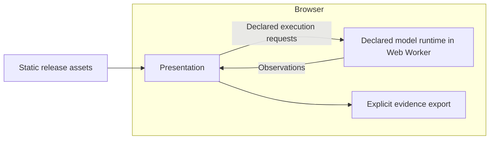

# Website architecture and execution parity

This document owns website delivery, runtime placement and pre-deployment confidence.
[Execution delivery](delivery.md) owns evidence representation and retrieval;
[inspection](inspection.md) owns the connected views. Interface shapes remain owned
by the [data model](../../data-model/README.md).

## Execute in the browser

The public site serves static assets and executes declared model operations in a
Web Worker. Every operation runs in one Python engine through Pyodide: a NumPy
decoder for all shipped models, the byte-pair and 384-ID tokenizers, and the
resource simulation. Architecture and precision select explicit operators within
that engine; component tests run the same code natively. There is no numerical
fallback on a failed browser execution.
The original [feasibility spike](../research/browser/browser-execution-spike.md) remains historical evidence.
Broader browser/device qualification and larger simulations remain unproven.
Remote compute is an alternative only if measured limitations or a specific lab
justify it. Lambda is no longer the planned deployment target.

For these small models and hypothetical resource simulations, Lambda would
move CPU computation elsewhere without making the abstraction more representative.
Browser execution avoids mandatory prompt uploads, remote evidence storage and
compute-service operations. It still has asset-delivery costs, runtime startup
costs and device-dependent limits; those must be measured.

## Preserve interfaces independently of placement

| Boundary | Owns | Does not own |
| --- | --- | --- |
| Presentation | Editing, submission, selection, rendering and inspection | Numerical equations, resource scheduling or alternate settings |
| Execution | Validation, numerical work, resource simulation and observations | DOM updates or website assembly |
| Evidence | Accepted in-memory observations and explicit export | Model policy or the simulated memory hierarchy |
| Model asset storage | Verified immutable weights/tokenizers via the same HTTP interface locally or from object storage | Numerical execution, prompt collection or simulated KV residency |
| Transport/runtime | Carry declared requests and results; supply execution capabilities | Change operation meaning according to deployment location |

These interfaces remain essential when components share a browser. Presentation
must not reach into Python globals or storage internals, mutate accepted evidence,
or reimplement model algorithms. Worker messaging must consume the same generated
request/result declarations. Admit requests before execution; verify complete response
schemas in the integration harness, not by walking engine-produced tensors on every
token. Retain execution bounds and stale-result checks in production. Runtime-specific
message envelopes must be declared and governed before implementation, not invented
inside UI code. Request correlation, failures and lifecycle behavior need explicit
semantics; placing code in a worker does not establish them automatically.

No HTTP compute binding, receipt store or artifact-retrieval operation is implemented.
The main page retains accepted evidence in memory and exports it explicitly.
Persistence across reloads requires a named consumer and declared behavior before
implementation. Evidence is not simulated HBM or KV residency. Visitor inputs and
generated evidence remain on-device.

## What the browser simulates

Actual browser execution produces logits and selected tokens; the inspectable
model also captures intermediate tensors. A resource model
accounts for hypothetical compute service, memory capacity/bandwidth, transfers,
queues and dependencies using virtual time. Browser wall time records how long the
simulation took to run; it is not the predicted accelerator time.

A small declared memory budget must govern admission and residency, not merely
label a diagram while computation accesses supposedly absent weights. Topology,
contention and placement require executable rules and independent checks. Moving
the simulator to a server does not supply those rules or validate their realism.
The current resource graph does not yet execute arbitrary topology scheduling;
full MoE and multi-node simulation remain separate milestones.

## Feasibility evidence

The [spike report](../research/browser/browser-execution-spike.md) records the tested scope,
costs, numerical differences and limitations. Its
[evaluation record](../../governance/evaluations/records/2026-10/browser-execution-spike.yaml)
owns the predeclared thresholds. The same Python engine executed declared workloads,
selected-prefix stepping and KV resource interventions inside a browser worker with
no compute service. Runtime provenance remains distinct; scientific claims still
require their own abstraction and calibration evidence.

The retired spike was fixed-case research instrumentation. The product worker now
consumes declared execution operations. Its implementation reuses Pyodide's worker
pattern and pinned package distribution. React/Vite adoption is independent.

## Loading and asset delivery

The [model asset boundary](delivery.md#model-assets) owns lazy model loading and
storage configuration. Larger weights are separate from the core engine package
and are fetched only after an explicit load action. They do not enlarge the
initial model download. The selected model owns its tokenizer and numerical
evidence; switching clears the previous continuation and observations.

Keep the standard pinned Python runtime for now. The
[asset-size audit](../research/browser/browser-execution-spike.md#asset-size-follow-up)
measures roughly 6.0 MiB with gzip; this is neither a WASM minimum nor verified
production transfer size. A custom stripped runtime needs evidence that its size
benefit justifies maintenance and compatibility costs.

Serve compressed assets and cache versioned runtime files. Render the interface
first and initialize execution independently in its worker. Keep editing available;
show compact downloading, initializing, ready or failed states beside execution.
Only show numeric progress when measured. Enable execution once ready and offer
a clear failure. Current loading shows a compact engine-loading message; reload
retries initialization. Detailed download progress and CDN cache policy remain
deployment work. Verify fresh and cached loads and actual transfer sizes before deployment.

## Local testing before static deployment

The target is the same static release running the same browser execution path
locally and publicly. Testing only the native socket service cannot qualify that
path. The [Makefile](../../Makefile) owns workflows. The static-only browser harness
implements execution parity; hosted/CDN and multi-browser qualification remain deployment work.

- Build one release containing pinned runtime/dependency assets, generated
  declarations, Python code and required model data. Serve that bundle locally;
  promote the tested bytes rather than rebuilding them during deployment.
- Run browser tests with no compute API available. Exercise real execution,
  configuration changes, stepping, artifact inspection and export, so an embedded
  recording cannot disguise a broken execution path.
- Run the same declared cases headlessly and interactively through the same
  browser worker. Preserve exact evidence, including runtime provenance. Native
  component tests check equations independently; they do not define browser tokens.
- Check fresh and cached loads, missing assets, stale release combinations,
  worker startup/failure, supported browsers and evidence loss across reloads.
  Missing prerequisites fail a requested gate rather than silently skipping it.
- Verify deployment-relevant asset paths, MIME types, caching, worker loading and
  required browser security headers locally. After publishing, run a small smoke
  corpus against the actual origin to verify CDN, TLS, headers and delivered asset
  identity. Local tests cannot establish those hosted properties.

Cross-runtime comparisons, when an investigation actually needs them, must report
near-tied logit margins and token flips separately from numerical tolerance. They
are diagnostics, not a requirement to maintain a second product runtime.

Keep numerical correctness in component tests and runtime composition in
integration. Share builds and fixtures; preserve existing harness budgets.
Physical measurements, browser responsiveness and virtual simulation outcomes
remain separate claims even when all checks pass.

Native Python remains build, preparation and component-test tooling. A future
native product execution path must name a browser limitation or physical measurement
requirement. Speeding up these tiny models is not such a requirement.

Model assets may be served from S3 through ordinary public HTTPS/CORS; no AWS SDK
or credentials enter the browser. [Delivery](delivery.md) owns operation and storage details.

## AWS dev delivery

[Deployment configuration](../../infrastructure/aws/deployment.yaml) owns the account,
region and environment state. Only dev is enabled. Production was published prematurely;
its distribution is disabled and its A/AAAA aliases are removed. The registered domain,
private retained bucket and previous release evidence remain. Production publication is
future work, not a step in the current workflow.

The [Makefile](../../Makefile) owns local serving, qualification, packaging, dev publication,
hosted verification and explicit release restoration. The integrated dev publication target
runs the full local harness, seals its exact output, deploys it and checks the actual origin.
An existing sealed release can also be deployed explicitly. There is no production-promotion
target. Disabled environments are rejected before any deployment writes.

CNCRover's reference implementation is `mk/release.mk` and
`omnicarve-cloud/cdk/lib/static-site-stack.ts`: staging deployment is distinct from a
commented-out production stack, and CloudFront resolves clean routes internally. Its
release archives are delivery artifacts, not navigation URLs. We use those boundaries
with the existing CloudFormation and browser-only application. We do not inherit its
missing-file-to-HTML success fallback or application/build Lambdas.

The application is served at `/`. Ontology declarations remain internal inputs to the
system map and explanations; their reference pages are not published. CloudFront internally
selects the active release's document; it sends no navigation redirect. HTML requires
cache revalidation. The release ID remains an internal storage and qualification identity.
A function update changes the document selection without rewriting the visitor's URL.

The static builder places scripts, styles, workers, Python/WASM and models in one
content-addressed payload under `/assets/<sha256>/`. Documents reference that payload
explicitly. Worker-relative imports and model loading stay inside the same payload.
Changing the active document release cannot change an existing tab's resource URLs.
The payload hash excludes HTML, avoiding a self-referential release hash. Local and
hosted environments consume the same built directory, including clean directory indexes.

S3 retains complete checksum-qualified releases plus immutable payloads. The CloudFront
origin access policy denies anonymous S3 reads. Missing routes and assets remain errors;
internal HTML release paths are not public entry points. Legacy non-HTML release resources
remain readable so already-open tabs survive this layout migration. Restoring an archive
does not itself qualify its layout for current deployment.

Verification starts at the public root, requires HTTP 200 without Location, compares all
served bytes, checks HTTPS, MIME types, caching, compression and missing-file failures,
and exercises model execution and clean navigation in fresh and warm Chrome sessions.
Edge-function tests evaluate document selection and invariant asset paths across a release
change. Hosted verification is separate from the budgeted local harness; browser coverage
is limited to the installed Chrome. It does not establish all-region rollout atomicity.

Runtime and model downloads incur S3/CloudFront transfer charges even though inference
runs on-device. DNS and annual registration are separate costs.

## Interaction timing

The Interaction panel separates functional input/output from measured browser responsiveness.
`ExperimentObservation` owns browser token timings in the generated contracts. Each sample binds
an accepted prediction to a monotonic gesture-start and output-DOM-update timestamp. Downloaded
generation evidence retains a compact per-token ledger and observer batches; the display derives its metrics from them.

TTFT is available for a fresh continuous generation that produces decoded text. It excludes prior
model loading/input preparation and does not claim physical screen-paint timing. Inter-token
intervals stay within one Generate gesture; manual clicks and stop/resume gaps are excluded.
Manual stepping shows its own gesture-to-update latency. Reset and configuration changes clear
the trace; branching starts a new trace. Token count comes from accepted output IDs, including
terminal tokens. Browser/UI overhead is included, so these are not isolated model benchmarks.
Resource simulation retains its separate virtual clock and does not populate measured timings.

The owned measurement scopes live in `GenerationPrediction`, `BrowserTokenTiming` and
`BrowserObserverBatch` in the data model. Decoder duration includes the model-declared
capture behavior. Service duration additionally encloses selection and response construction,
excluding input admission and structured buffer conversion. Both are worker durations; browser timestamps
have a separate clock domain and cannot be subtracted from worker timestamps.

The shared measured-dispatch controller waits for earlier operations and rechecks request
identity before dispatch. The Generate gesture clock starts before that wait; TTFT therefore
includes it. Dispatch minus gesture start is pre-dispatch delay, not pure queue time.
Output publication is timestamped immediately after the DOM mutation. Inspection and chart
rendering are scheduled separately, with synchronous start/end observations grouped by
covered token ordinals. Completion lag also includes scheduling; neither quantity measures
physical paint or total counterfactual observer overhead. Missing observer batches mean
unmeasured/pending/skipped work, never zero cost. Export does not force a render.
