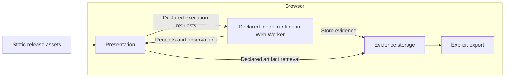

# Website architecture and execution parity

This document owns website delivery, runtime placement and pre-deployment confidence.
[Execution delivery](delivery.md) owns evidence representation and retrieval;
[inspection](inspection.md) owns the connected views. Interface shapes remain owned
by the [data model](../../data-model/README.md).

## Execute in the browser

The public site serves static assets and executes declared model operations in a
Web Worker. The inspectable engine uses Python through Pyodide; larger
models use pinned upstream llama2.c compiled to WebAssembly. Model selection
chooses one numerical implementation, not separate local and hosted products. The
[feasibility spike](../research/browser-execution-spike.md) passed for the reference
model and existing KV simulation on desktop Chromium. The product now uses that execution path.
Broader browser/device qualification and larger simulations remain unproven.
Remote compute is an alternative only if measured limitations or a specific lab
justify it. Lambda is no longer the planned deployment target.

For these small models and hypothetical resource simulations, Lambda would
move CPU computation elsewhere without making the abstraction more representative.
Browser execution avoids mandatory prompt uploads, remote evidence storage and
compute-service operations. It still has asset-delivery costs, runtime startup
costs and device-dependent limits; those must be measured.

## Preserve interfaces independently of placement

| Boundary | Owns | Does not own |
| --- | --- | --- |
| Presentation | Editing, submission, selection, rendering and inspection | Numerical equations, resource scheduling or alternate settings |
| Execution | Validation, numerical work, resource simulation and observations | DOM updates or website assembly |
| Evidence storage | Identified immutable records, artifact retrieval and export | Model policy or the simulated memory hierarchy |
| Model asset storage | Verified immutable weights/tokenizers via the same HTTP interface locally or from object storage | Numerical execution, prompt collection or simulated KV residency |
| Transport/runtime | Carry declared requests and results; supply execution capabilities | Change operation meaning according to deployment location |

These interfaces remain essential when components share a browser. Presentation
must not reach into Python globals or storage internals, mutate accepted evidence,
or reimplement model algorithms. Worker messaging must consume the same generated
request/result declarations. Admit requests before execution; verify complete response
schemas in the integration harness, not by walking engine-produced tensors on every
token. Retain execution bounds and stale-result checks in production. Runtime-specific
message envelopes must be declared and governed before implementation, not invented
inside UI code. Request correlation, failures and lifecycle behavior need explicit
semantics; placing code in a worker does not establish them automatically.

No HTTP compute binding is implemented. The browser does not simulate a web server
to preserve the interface. Existing receipt and artifact
interfaces remain useful for separating compute from inspection and storage;
co-location is not permission to collapse them into shared mutable objects.

Browser evidence may initially live in memory with explicit export. Persistence
across reloads, storage quotas and eviction require declared behavior before a
persistent browser store is offered. No receipt should imply durability beyond the
selected store's lifetime. Evidence storage is not simulated HBM or KV residency.
Visitor inputs and generated evidence should remain on-device unless an explicit
feature requests their transfer.

## What the browser simulates

Actual browser execution produces logits and selected tokens; the inspectable
Python engine also captures intermediate tensors. A resource model
accounts for hypothetical compute service, memory capacity/bandwidth, transfers,
queues and dependencies using virtual time. Browser wall time records how long the
simulation took to run; it is not the predicted accelerator time.

A small declared memory budget must govern admission and residency, not merely
label a diagram while computation accesses supposedly absent weights. Topology,
contention and placement require executable rules and independent checks. Moving
the simulator to a server does not supply those rules or validate their realism.
The current resource graph does not yet execute arbitrary topology scheduling;
full MoE and multi-node simulation remain separate milestones.

## Feasibility evidence

The [spike report](../research/browser-execution-spike.md) records the tested scope,
costs, numerical differences and limitations. Its
[evaluation record](../../governance/evaluations/records/2026-10/browser-execution-spike.yaml)
owns the predeclared thresholds. The same Python engine executed declared workloads,
selected-prefix stepping and KV resource interventions inside a browser worker with
no compute service. Runtime provenance remains distinct; scientific claims still
require their own abstraction and calibration evidence.

The retired spike was fixed-case research instrumentation. The product worker now
consumes declared execution operations. Its implementation reuses Pyodide's worker
pattern and pinned package distribution. React/Vite adoption is independent.

## Loading and asset delivery

The [model asset boundary](delivery.md#model-assets) owns lazy model loading and
storage configuration. Larger weights are separate from the core engine package
and are fetched only after an explicit load action. They do not enlarge the
initial model download. The selected model owns its tokenizer and numerical
evidence; switching clears the previous continuation and observations.

Keep the standard pinned Python runtime for now. The
[asset-size audit](../research/browser-execution-spike.md#asset-size-follow-up)
measures roughly 6.0 MiB with gzip; this is neither a WASM minimum nor verified
production transfer size. A custom stripped runtime needs evidence that its size
benefit justifies maintenance and compatibility costs.

Serve compressed assets and cache versioned runtime files. Render the interface
first and initialize execution independently in its worker. Keep editing available;
show compact downloading, initializing, ready or failed states beside execution.
Only show numeric progress when measured. Enable execution once ready and offer
a clear failure. Current loading shows a compact engine-loading message; reload
retries initialization. Detailed download progress and CDN cache policy remain
deployment work. Verify fresh and cached loads and actual transfer sizes before deployment.

## Local testing before static deployment

The target is the same static release running the same browser execution path
locally and publicly. Testing only the native socket service cannot qualify that
path. The [Makefile](../../Makefile) owns workflows. The static-only browser harness
implements execution parity; hosted/CDN and multi-browser qualification remain deployment work.

- Build one release containing pinned runtime/dependency assets, generated
  declarations, Python code and required model data. Serve that bundle locally;
  promote the tested bytes rather than rebuilding them during deployment.
- Run browser tests with no compute API available. Exercise real execution,
  configuration changes, stepping, artifact inspection and export, so an embedded
  recording cannot disguise a broken execution path.
- Run the same declared cases headlessly and interactively through the same
  browser worker. Preserve exact evidence, including runtime provenance. Native
  component tests check equations independently; they do not define browser tokens.
- Check fresh and cached loads, missing assets, stale release combinations,
  worker startup/failure, supported browsers and evidence loss across reloads.
  Missing prerequisites fail a requested gate rather than silently skipping it.
- Verify deployment-relevant asset paths, MIME types, caching, worker loading and
  required browser security headers locally. After publishing, run a small smoke
  corpus against the actual origin to verify CDN, TLS, headers and delivered asset
  identity. Local tests cannot establish those hosted properties.

Cross-runtime comparisons, when an investigation actually needs them, must report
near-tied logit margins and token flips separately from numerical tolerance. They
are diagnostics, not a requirement to maintain a second product runtime.

Keep numerical correctness in component tests and runtime composition in
integration. Share builds and fixtures; preserve existing harness budgets.
Physical measurements, browser responsiveness and virtual simulation outcomes
remain separate claims even when all checks pass.

## Current implementation

The public site uses a generated browser client and worker. The worker runs
the inspectable Python engine through Pyodide, with in-memory artifacts and lossless
export/replay for the existing request/KV labs. The optional model-family lab uses
the same declared operation boundary; its larger models execute upstream C in
WebAssembly and expose tokens/logits, not full tensor traces or archive replay. The local preview server serves static files only. There is no
native HTTP compute path, CUDA backend or Lambda bridge. Model assets may be
served from S3 through ordinary public HTTPS/CORS; no AWS SDK or credentials enter
the browser.

The [delivery boundary](delivery.md) owns operation and storage details. The
integration harness drives both headless and interactive calls in Chromium. Their
runtime, engine package, declarations and static assets are the same. A native
versus WASM tolerance comparison is not the product parity gate: near-tied logits
can change argmax even when numerical differences are tiny.

Native Python remains build, preparation and component-test tooling. A future
native execution path must name a browser limitation or physical measurement
requirement. Speeding up this tiny model is not such a requirement.

The previous browser/native feasibility results above and in research documents
are historical evidence. They do not promise identical tokens between runtimes.
