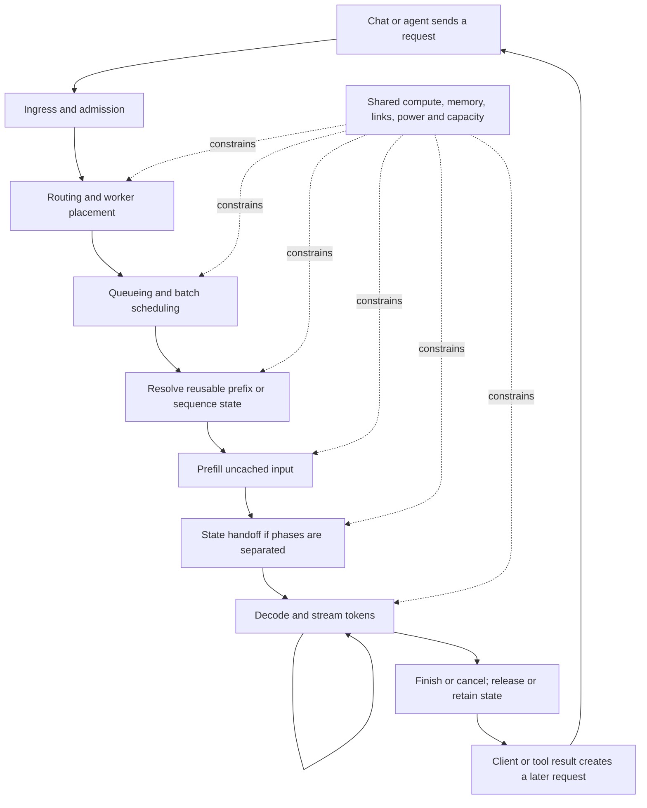

# Purpose: learn inference by following a request

> What happens if you change this?
>
> Understand what changed in AI inference. See the mechanism. Find its place in the stack.

Inside Inference is a personal learning project, built in public. Its primary goal
is to help its author understand inference through implementation, observation,
and experimentation. Helping other readers is a welcome outcome. A competitive
advantage, an unoccupied niche, or audience growth is not a prerequisite for work.
Existing explainers are learning resources and presentation references.

The reader should be able to understand an innovation in two connected ways:

1. Observe its underlying mechanism in a visually approachable form.
2. Locate what it changes in the inference ecosystem and follow the consequences.

## Inference is the research boundary

This project explores inference mechanisms and their system consequences. Training
is a prerequisite for obtaining usable checkpoints, not a subject for serious
experimentation here. Implement or reuse enough model preparation to support
faithful inference and controlled comparisons. Optimizer research, training-method
sweeps, and post-training curricula are outside the current mission. A mechanism
may require new compatible weights; that is supporting work, not a new research
axis. See [model preparation](../implementation/model-preparation.md).

## Fixed language, inspectable computation

The initial nano-GPT vocabulary size is **frozen at 384 total token IDs**, including
lexical entries, punctuation, control tokens, and fallback symbols. This is the
model vocabulary size, not hidden width or a promise of 384 spoken words. Any
future size change requires an explicit contract revision and separately identified
experiments. The [vocabulary audit](../research/vocabulary-budget.md) records the
rationale; its earlier candidate status is historical.

The spoken lexicon will use simple, everyday words inspired by language familiar
to a three-year-old, within a deliberately bounded world. It should support
requests, questions, clarification, negation, feelings, ownership, and short
context-dependent exchanges. This is not a developmental model of a child.
An initial [384-entry manifest](../../data/tokenizer/README.md), reversible codec,
and [bounded corpus recipe](../../data/corpus/README.md) now exist. The lexical
selection is a candidate with known everyday coverage gaps; it is not a trained
model or a validated conversational vocabulary. Freeze and version an accepted
manifest before training or mechanism comparisons.

Unfamiliar input is a learning opportunity: foreign scripts, large words, names,
misspellings, and mixed scripts belong in tokenizer experiments. The design
baseline is reversible UTF-8 byte fallback represented by a BYTE marker and two
hexadecimal symbols per byte, within the same 384 IDs. It must expose original
spans, bytes, token IDs, fallback decisions, sequence expansion, and context cost.
Case and Unicode normalization must not silently alter input. Decoding a supported
input must reconstruct it exactly; malformed encodings and context overflow must
be explicit, with no silent replacement or truncation. The
[implemented codec](../implementation/tokenizer.md) supplies this behavior;
the earlier vocabulary counting script remains a separate budgeting instrument.

Input representability does not imply learned meaning or multilingual ability.
The default conversation experiment produces words from the declared simple
lexicon; any output constraints must be visible in the decoding configuration and
trace, including raw logits and the distribution after constraints. Control tokens
are not spoken text. An explicit unrestricted fallback-generation experiment may
study invalid byte sequences and unfamiliar strings, but must not be presented as
the default closed-lexicon conversation. Full tokenizer rules and output constraints
must be specified and tested before model training.

Small vocabulary is intentional: readers should be able to inspect every logit,
embedding row, and token decision. It does not freeze attention, state mechanisms,
precision, scheduling, or resource experiments. The wider system observatory
remains in scope around this bounded numerical instrument.

Use three connected zoom levels: **customer journey → execution steps → mechanism
configuration and numerical detail**. Prefill and decode both expose the model's
internal operations, including embeddings and attention. Selecting an attention
alternative must eventually run real computation and reveal its trace, rather
than merely change the diagram. See the [inspection architecture](../architecture/inspection.md)
for code boundaries and the incremental implementation path.

## Organize around the request journey

Start with a concrete question: **an agent or chat client sends a request; what
happens next, and what would change if one mechanism were different?**

The following is a conceptual journey for future labs, not a claim that every
serving system has this architecture or that this repository implements it today.
Stages can be colocated, reordered, repeated, or absent under a stated scenario.

The layer index locates responsibilities. A request trace connects them over
time. Both views should lead to the same labs and use the same terminology.
A paper-specific explanation is one view into this system, not the whole story.

## Start with the simplest faithful computation

Build and explain a naïve decoder-only GPT before adding inference optimizations.
Then introduce one change at a time: reuse K/V, expose ordinary multi-head
attention, and study sharing such as MQA. More advanced attention/state mechanisms
can follow an understood reference. Novelty does not determine priority; an
existing KDA side lab does not bypass this sequence. The
[milestones](milestones.md#build-order-establish-the-reference-before-changing-it)
own the incremental plan and acceptance criteria.

## Connect local mechanics to system behavior

A useful lab makes a causal question inspectable. Examples to investigate, not
results already established here:

| Intervention | Follow through the request journey |
| --- | --- |
| Change attention or sequence state | State representation → storage and reads → feasible batches → request timing, with quality assessed separately. |
| Reuse a prompt prefix | Cache identity and residency → work avoided or state transferred → queueing and time to first token. |
| Route toward cached state | Reuse benefit versus a worker's load, transfer path, and waiting time. |
| Change scheduling | Batch membership and preemption → utilization, request interference, fairness, and completion time. |
| Separate prefill and decode | Placement → handoff volume and link contention → phase utilization and token delivery. |
| Change hardware or memory tier | Compute, capacity, and bandwidth constraints → a possible bottleneck shift elsewhere. |
| Add agent tool turns | Arrival timing, shared prefixes, and idle gaps → cache retention, eviction, and repeated work. |

An improvement in one operation is not automatically an improvement in a whole
request or a shared service. Show where saved work goes, what remains on the
critical path, and which resource becomes limiting. Distinguish one request's
experience from aggregate throughput and other requests' waiting time.

## The abstraction is the core work

The central artifact is a justified abstraction of the problem. Code makes that
abstraction executable; visualization and game interactions make it inspectable.
A working, engaging simulation can still teach the wrong causal model.

Keep three questions separate:

| Question | Evidence needed | What it does not establish |
| --- | --- | --- |
| Can it run? | Browser/backend execution, responsiveness, bounded resource use. | Correct computation or a representative abstraction. |
| Did we implement the specified model correctly? | Independent calculations, invariant checks, reference comparisons, and trace checks. | Whether the specified model captures the real question. |
| Is the abstraction adequate for this question? | A justified mapping to the target system, preserved causal dependencies, and analytical or empirical validation over stated conditions. | Validity for other questions, workloads, or scales. |

Validity belongs to a claim under conditions, not to a simulator as a whole.
A cache model may establish correct reuse while saying nothing reliable about
latency. A recurrence demo may compute exact state updates while saying nothing
about learned semantic features or model quality. Passing tests for either does
not validate a larger inference-system explanation.

Before choosing a visualization or implementing a simulator, state the question,
the proposed conclusion, and the regime in which it should hold. Identify the
state, constraints, and causal relationships needed to answer it. Explain what
is omitted and why that omission should not change the answer. If it could change
the answer, include it, narrow the claim, or leave the answer unresolved.

For example, a question about whether retrieving a cached prefix is faster than
recomputing it cannot be answered by showing a cache-hit animation. The abstraction
must account for the relevant residency, dependencies, retrieval path, waiting,
and recomputation work under the chosen workload. Representing tiers with a few
parameters is a hypothesis to validate for that question, not sufficient evidence
that real storage behavior has been represented.

Choose validation appropriate to the claim: derivation for an idealized property,
an independent implementation for algorithmic behavior, or reference measurements
and traces for empirical timing claims. If parameters are fitted to measurements,
check additional cases not used for fitting. Probe boundary cases, counterexamples,
and sensitivity to uncertain assumptions. Agreement on one example, or matching
one aggregate number, is insufficient evidence for general behavior.

A visible warning cannot repair an invalid abstraction. Unsupported predictions
must remain hypotheses; omit a numerical verdict or winning policy when the model
cannot support one. If a known simplification teaches the wrong mechanism, fix it
or withdraw that explanation. Do not present known errors as acceptable toy behavior.

The game should reward investigating and explaining consequences within a stated
model. Its scoring, animation, and progression must not introduce fictional causal
rules that readers could mistake for inference behavior. An illustrative analogy
can orient a reader, but it is not experimental evidence.

The [ontology](../ontology/README.md) defines the shared entities and experiment
contracts used to put this principle into practice. Its
[abstraction contract](../ontology/experiment.md#abstraction-contract) separates
the evidence for representativeness from the measured cost of execution.

## Use the right instrument

The tiny GPT is one instrument for studying inference arithmetic and learned behavior. It need not
simulate every part of a serving system. Use small state machines for cache
semantics, event simulations for queues and scheduling, analytical resource models
for hardware thought experiments, and real traces when execution details matter.

An intended reusable artifact is a tiny reference model for testing inference
changes cheaply with real, inspectable computation. Its checkpoint, tokenizer,
inputs, and traces could support reproducible correctness tests and connect to
explicit system simulations. This is a step between a mathematical proposal and
deployment evidence, not a replacement for calibrated hardware models, realistic
workloads, or cluster measurements. Fewer parameters than another tiny model is
not a success criterion; preserving the mechanism under study is.

The central configurable object is the inference system: input preparation,
model computation, serving policies, state placement, and resource constraints.
A worker is one execution location inside it. Start with one selected client
workload and expose more internal detail as needed, including tokenization,
embeddings, layer computation, logits, token selection, and output decoding.
The nano-GPT must supply real numerical traces for those stages; visualization
is an inspection surface for computation and simulation.

A first connected simulator should be deliberately small: a reproducible request,
bounded execution resources, prefix-state residency, and explicit service
and transfer assumptions. Add queues and competing requests when studying contention. First make its baseline timeline inspectable. Then
change one policy and replay the same workload. The landing-page
[request playground](../labs/request-playground.md) implements a bounded,
idealized instance of this direction. It is not a production serving engine
or a validated predictor of real-system timings.

Simulation must expose its assumptions: arrival times, input/output lengths,
shared prefixes, policy, resource capacity, memory budget, transfer bandwidth and
latency, and how service times are obtained. Introduce power, cooling, topology,
and failure constraints when they answer a concrete learning question. Avoid
implying that an unmodeled data-center limit has been accounted for.

## What counts as learning evidence

Keep four kinds of evidence distinct: mathematical properties, measured toy
behavior, simulated system behavior, and external measurements. Record conditions
and sources. Animations should display computed transitions or clearly identify
an illustrative analogy; visual polish is not validation.

Tiny experiments and simulations can produce false positives and false negatives.
A toy success may disappear with different training, scale, arrivals, or hardware;
a toy failure may conceal a useful real-world technique. State specifically what
could reverse the apparent result. Never use uncalibrated simulator timings as
claims about real deployments.

Success means being able to explain a transition, predict an intervention's
consequence, and identify the assumptions on which that prediction depends.
Public feedback can improve the explanation, but audience metrics do not decide
whether an experiment was worthwhile. The [milestones and acceptance criteria](milestones.md)
define the first instrument’s measurable targets and separate them from the current
bootstrap checkpoint. Targets are not claims of results already achieved.

## Public presentation

Use [Rudrite Research](https://research.rudrite.com/) and
[Attention Lab](https://divagr.com/attention-lab) as references for visual
explanation and approachable exploration. Credit references and retain our own
explicit evidence boundaries.

The intended public experience has two entrances: follow a request, or look up an
innovation and jump to its position in that journey. Start with an accessible
visual explanation, allow a controlled intervention, and reveal equations, raw
traces, and implementation details on demand. Link mechanisms across layers.

Keep readable prose in Markdown for GitHub and agents, with interactive browser
views for transitions that static text cannot communicate well. Use stable lab
URLs and show what is working, planned, simulated, or still uncertain. Publish
learning progress and corrections without waiting for a complete model or atlas.
The working public name is **Inside Inference**, with **insideinference.dev** as
the intended public address. Registration, availability, and deployment are not
established by this decision. Keep generated pages portable and local links
relative until a hosting implementation needs domain-specific configuration.

## Document ownership

This document owns the current purpose, learning priorities, and presentation
direction. The root [README](../../README.md) introduces the purpose and philosophy;
[development workflows](../development.md) own setup, commands, and entry points.
The [ontology](../ontology/README.md) owns shared meanings and experiment
contracts. The [catalog](../../catalog/README.md) owns indexing conventions;
executable code owns implemented behavior.

The [original laboratory plan](original-lab-plan.md) preserves the initial DOCX
proposal in Markdown. Its tiny-model design remains useful background. Its
weekend deadlines, competitive framing, release prerequisites, and assumption
that all experiments revolve around one model are historical rather than current
project requirements. The original DOCX is not present in this checkout; the Markdown conversion is
the maintained historical reference.
